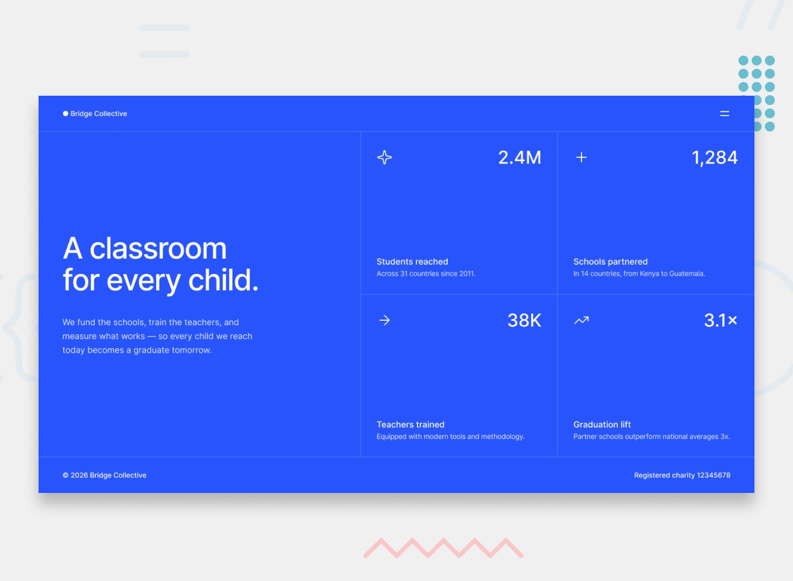

# Frontend Mentor - Grid landing page

## Links

- Live site: https://code-surgeon-hossam.github.io/grid-landing-page/
- Repository: https://github.com/Code-Surgeon-Hossam/grid-landing-page

## Built with

- Semantic HTML5
- CSS3 (Grid, Flexbox, media queries)
- JavaScript (menu toggle)
- Mobile-first workflow

## What I learned

In this project I practiced CSS Grid for the first time: one grid splits the
page into text and stats, and a second grid arranges the four stats in a 2x2
layout. I also learned how to make a layout that changes between mobile and
desktop with media queries.

I built a navigation menu that opens and closes with JavaScript, and I
learned why it is important to update `aria-expanded` and `aria-label` so
the menu works for screen reader users. I also learned to close the menu
with the Escape key.

## Author

- GitHub: [@Code-Surgeon-Hossam](https://github.com/Code-Surgeon-Hossam)
